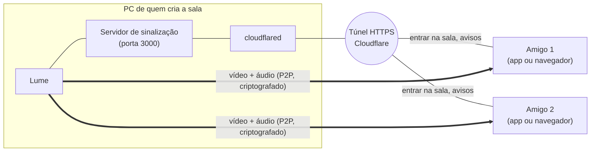

<p align="center">
  
</p>

<h1 align="center">Lume</h1>

<p align="center">
  Compartilhe sua tela com áudio com os amigos, no estilo do Discord, sem servidor pago e sem conta.<br>
  <b>Electron + WebRTC</b> · Windows · v1.8.0
</p>

---

## O que é

O Lume é um programa para assistir à tela de alguém junto com os amigos: um jogo, um filme, um código, uma apresentação. Uma pessoa cria a sala, manda o link, e quem entra vê e ouve tudo em tempo real. Várias pessoas podem compartilhar ao mesmo tempo, e as telas se organizam sozinhas na janela.

Quem só quer **assistir** não precisa instalar nada: o link abre no navegador. O app desktop é para quem quer **compartilhar** com a melhor qualidade.

## Recursos

- **Salas por link:** crie uma sala e copie o link público com um clique.
- **Tela e áudio do sistema:** escolha uma tela inteira ou só uma janela. No Windows, o som do PC vai junto automaticamente.
- **Até 1080p a 60 fps**, com codec H.264 (usa a placa de vídeo) ou VP9.
- **Vários espectadores e vários compartilhando ao mesmo tempo** (até 12 pessoas por sala).
- **Prévia antes de assistir:** quando alguém compartilha, os outros veem só uma prévia leve (sem som). Quem quiser assistir clica em **▶ Assistir** e recebe a tela em qualidade total com áudio. O ✕ volta para a prévia, e quem compartilha vê quantas pessoas estão assistindo.
- **Layout automático:** as telas se reorganizam para ficar o maior possível.
- **Volume e tela cheia** separados para cada tela.
- **Sons de aviso** quando alguém entra, sai, começa ou para de compartilhar (dá para desligar).
- **Fica na bandeja:** fechar a janela não encerra o app, e a sala continua no ar.
- **Economia de recursos:**
  - cada espectador recebe só a resolução que está usando;
  - quem minimiza deixa de receber vídeo (o áudio continua);
  - a prévia da própria tela é leve.
- **Link público automático** via túnel da Cloudflare, sem abrir portas no roteador.

## Como funciona



1. **Quem cria a sala** liga um pequeno servidor no próprio PC. O `cloudflared` expõe esse servidor na internet com um endereço `https://...trycloudflare.com`, sem precisar mexer no roteador.
2. **Os amigos** abrem o link. O servidor só faz a **sinalização**: quem entrou, quem saiu, quem está compartilhando e a troca de dados para os computadores se encontrarem.
3. **O vídeo e o áudio não passam pelo servidor.** Eles vão direto de um computador para o outro via **WebRTC**, criptografados de ponta a ponta (DTLS-SRTP). Um servidor STUN público do Google ajuda os PCs a descobrirem o endereço público um do outro, mesmo atrás de roteadores diferentes.
4. Quem compartilha envia **um fluxo para cada espectador**. Por padrão é só uma prévia: 320×180, 2 quadros por segundo e sem áudio, cerca de 150 kbps. Quando o espectador clica em **Assistir**, o fluxo dele passa para a qualidade total com áudio, ajustada ao tamanho em que ele vê a tela. Assim o upload de quem compartilha só é gasto com quem realmente está assistindo.

## Instalação e uso

### Requisitos

- Windows 10/11
- [Node.js](https://nodejs.org) 18 ou superior
- [cloudflared](https://developers.cloudflare.com/cloudflare-one/connections/connect-networks/downloads/), para o link público: `winget install --id Cloudflare.cloudflared`

### Rodar

```bash
npm install
npm start
```

- **Criar uma sala:** inicia o servidor. Deixe "Criar link público" marcado, entre na sala e clique em **Copiar link** para mandar aos amigos.
- **Entrar na sala de um amigo:** cole o link que ele te mandou.
- **Compartilhar:** clique em **Compartilhar tela**, escolha a tela ou janela e pronto. Na barra de baixo você ajusta áudio, qualidade, codec e prioridade (movimento ou nitidez).

### Gerar o executável

```bash
npm run dist
```

O resultado fica em `dist/Lume-win32-x64/`. Para distribuir, compacte **a pasta inteira**, porque o `Lume.exe` depende dos outros arquivos dela.

### Só o servidor, sem o app

```bash
npm run server
```

Abre em http://localhost:3000. Para compartilhar pelo navegador fora do seu PC é preciso HTTPS (por exemplo, `cloudflared tunnel --url http://127.0.0.1:3000`).

## Configuração

| O quê | Como |
|---|---|
| Porta | Na tela inicial do app, ou pela variável `PORT` no modo só servidor (padrão `3000`) |
| Servidor TURN | Variáveis `TURN_URL`, `TURN_USER` e `TURN_PASS` antes de iniciar. Só quem cria a sala precisa configurar |
| Ícone | Substitua `build/icon.ico` e `build/icon.png`. Há opções prontas em `build/alternativas/` |

## Riscos e limitações

O Lume é um **projeto pessoal, feito para uso entre amigos de confiança**. Ele não passou por auditoria de segurança. Antes de usar, conheça os pontos abaixo.

### Risco alto

- **Entrar no link de outra pessoa dá a ela acesso à sua tela.** Ao entrar na sala de alguém pelo app, a página dessa pessoa roda dentro do Lume com permissão para capturar a tela e o áudio do sistema, **sem pedir confirmação**. Um link malicioso, ou um amigo com o PC comprometido, poderia gravar sua tela principal e o som do PC sem você perceber. **Só entre em links de quem você confia.** Para apenas assistir a um link desconhecido, prefira o navegador.

### Risco médio

- **O link é a única proteção.** Não há senha nem aprovação de quem cria a sala: quem tiver o link entra e vê tudo o que for compartilhado. Não publique o link em lugares abertos.
- **O servidor aceita conexões da rede local.** Qualquer pessoa no mesmo Wi-Fi consegue acessar `http://SEU-IP:3000`.
- **Seu IP fica visível para quem está na sala.** Como a conexão é direta (P2P), os participantes veem o IP público uns dos outros.
- **Você pode mostrar mais do que pretende.** Compartilhar a tela inteira expõe notificações, mensagens e outras janelas. O áudio do sistema inclui tudo o que toca no PC, até chamadas e os próprios sons de aviso. Prefira compartilhar só uma janela.

### Risco baixo e limitações

- **Servidor sem proteção contra abuso:** não verifica a origem das conexões nem limita conexões e salas.
- **Links `http://`:** o conteúdo pode ser alterado no caminho. Use sempre o link `https://`.
- **Credenciais TURN visíveis:** se configuradas, são enviadas a todos os participantes da sala.
- **Dependências sem versão fixa:** `electron` e o empacotador estão em `latest`.
- **`cloudflared` procurado por pasta:** o app procura o programa também na pasta atual. Um arquivo falso com esse nome ali seria executado.
- **`.exe` sem assinatura digital:** o Windows SmartScreen mostra um alerta.
- **Túnel gratuito da Cloudflare:** não tem garantia de disponibilidade, e a Cloudflare enxerga o tráfego de sinalização (não o vídeo).
- **Qualquer espectador pode gravar** o que você compartilha.
- **Upload limita o número de espectadores:** cada pessoa assistindo consome até ~5 Mbps do seu upload em 1080p30. Quem está só na prévia gasta ~0,15 Mbps.
- **Algumas redes bloqueiam a conexão direta:** CGNAT de operadora, 4G/5G e redes corporativas podem exigir um servidor TURN.
- **Áudio do sistema só no Windows.**

### O que já está protegido

- Vídeo e áudio são criptografados de ponta a ponta pelo WebRTC.
- A interface isola a página do sistema: sem acesso ao Node.js e com `contextIsolation` ligado. A janela não navega para fora da sala.
- Nomes de usuário e de sala são exibidos como texto, sem executar código.

## Próximos passos

- [ ] Seletor de tela confiável no próprio app, para que nenhuma página consiga capturar sem confirmação
- [ ] Servidor escutando só em `127.0.0.1` por padrão
- [ ] Senha da sala ou aprovação de novos participantes
- [ ] Configuração de TURN na tela inicial
- [ ] Indicador de "ao vivo" no ícone da bandeja
- [ ] Versões fixas das dependências e `.exe` assinado

## Estrutura

```
main.js            processo principal do Electron (janela, bandeja, captura, túnel)
preload.js         ponte segura entre a página e o app
server.js          servidor de sinalização (HTTP + WebSocket)
start.html         tela inicial do app (criar ou entrar em sala)
public/index.html  sala: interface, WebRTC, layout e sons
build/             ícones do app e alternativas
```
