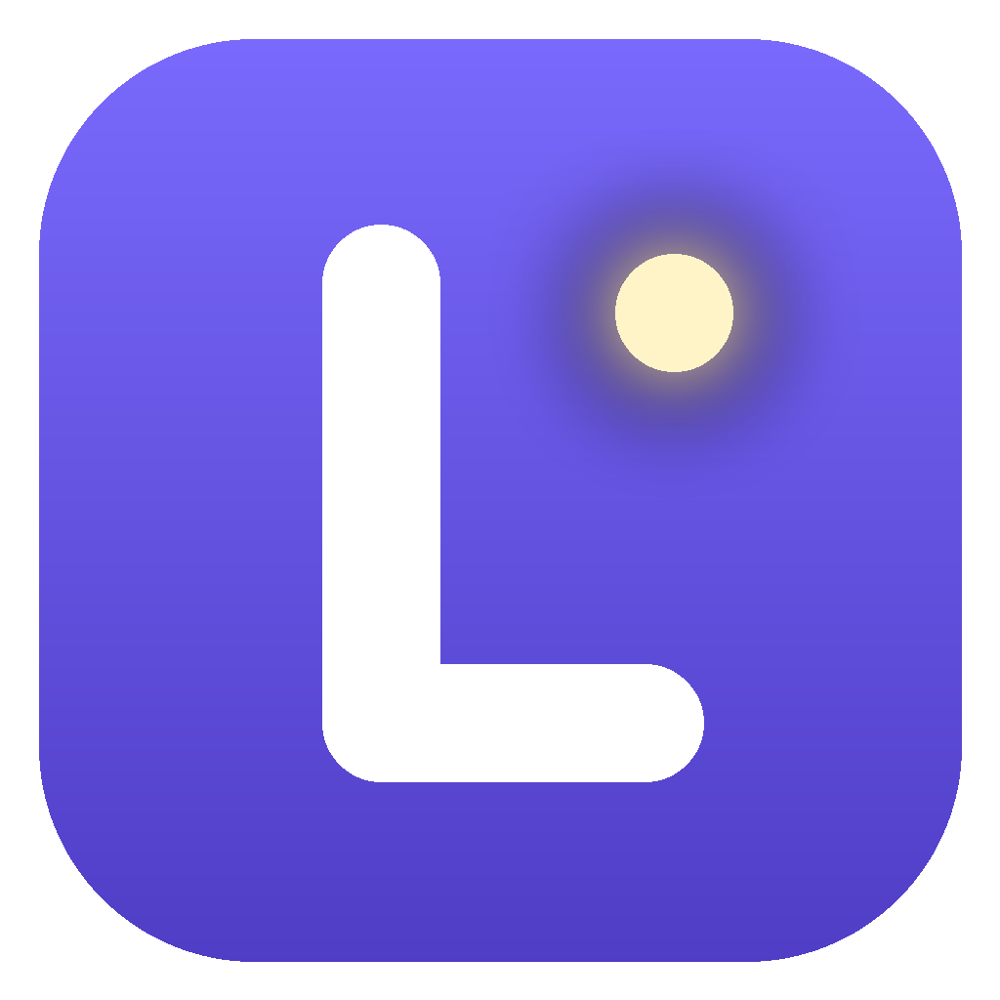

  

<h1 align="center">Lume</h1>

  Compartilhe sua tela com áudio com os amigos, no estilo do Discord, sem servidor pago e sem conta. 
  <b>Electron + WebRTC</b> · Windows

  

---

## Como funciona

Uma pessoa cria a sala no app e manda o link. Quem entra vê e ouve a tela em tempo real, pelo app ou pelo navegador. Várias pessoas podem compartilhar ao mesmo tempo, com até 12 pessoas por sala.

1. **O servidor roda no PC de quem cria a sala.** Ele só aceita conexões do próprio PC. O `cloudflared` cria um link público `https://...trycloudflare.com` até ele, sem abrir portas no roteador.
2. **O servidor só faz a sinalização:** quem entrou, quem saiu, quem está compartilhando e os dados para os PCs se encontrarem.
3. **O vídeo e o áudio não passam pelo servidor.** Eles vão direto entre os PCs via WebRTC, criptografados de ponta a ponta.
4. **Prévia e Assistir:**
   - quem compartilha envia a cada pessoa só uma prévia leve, sem som;
   - quem clica em **Assistir** passa a receber a qualidade total com áudio (até 1080p60), ajustada ao tamanho da tela dela.
5. **Seletor de tela confiável:** toda captura passa por uma janela do próprio Lume, que mostra quem está pedindo. Nenhuma página captura sua tela ou seu áudio sem a sua escolha.
6. **Áudio certo:**
   - ao compartilhar uma janela, vai só o som daquele aplicativo;
   - na tela inteira, vai todo o som do PC menos o do próprio Lume.

## Como usar

1. Baixe o `.zip` da **[última release](https://github.com/LuisFilipeZM/lume/releases/latest)**, descompacte a pasta inteira e abra o `Lume.exe`. Na primeira vez, o SmartScreen avisa que o app não é reconhecido: clique em **Mais informações → Executar assim mesmo**.
2. Para gerar o link público, instale o cloudflared: `winget install --id Cloudflare.cloudflared`.
3. Clique em **Criar sala**, defina uma senha se quiser e mande o link aos amigos. A senha não vai no link: mande separado.

O app avisa quando sai uma versão nova e só atualiza se você aceitar.

Para rodar a partir do código, testar ou publicar versões, veja [DESENVOLVIMENTO.md](DESENVOLVIMENTO.md).

## Riscos e limitações

O Lume é um **projeto pessoal, feito para uso entre amigos de confiança**, e não passou por auditoria de segurança.

### O que exige atenção

- **Entrar na sala de outra pessoa roda o código dela dentro do Lume.**
  - Ela não consegue capturar sua tela nem seu áudio sem a sua escolha no seletor, que avisa em destaque quando o pedido vem da sala de outra pessoa.
  - Mas, se você compartilhar, ela recebe a imagem e o som e pode gravar ou repassar.
  - Se o seletor aparecer sem você ter clicado em **Compartilhar tela**, cancele.
  - Para só assistir a um link de alguém que você não conhece, use o navegador.
- **Sem senha, o link é a única proteção.**
  - Quem tiver o link entra e vê tudo. Use senha se o link puder circular.
  - A senha fica só como hash na memória de quem criou a sala, e 5 erros bloqueiam o IP por 1 minuto. Mesmo assim, não é proteção forte: evite senhas óbvias.
  - Não há aprovação de novos participantes.
- **Seu IP fica visível para quem está na sala,** porque a conexão é direta (P2P).
- **Você pode mostrar mais do que pretende.** A tela inteira expõe notificações e outras janelas, e o áudio vai inteiro, incluindo chamadas. Prefira compartilhar só uma janela.
- **Qualquer espectador pode gravar** o que você compartilha.

### Riscos menores

- **Atualização confia nas releases do repositório:**
  - o `.exe` não tem assinatura digital, então quem conseguir publicar uma release aqui consegue distribuir uma "atualização";
  - o SHA-256 confere só se o download chegou inteiro;
  - por isso, a conta do GitHub deve ter autenticação em dois fatores.
- **O servidor não limita abusos:** não verifica a origem das conexões nem limita conexões e salas.
- **Túnel gratuito da Cloudflare:** não tem garantia de disponibilidade, e a Cloudflare enxerga a sinalização (não o vídeo).
- **Links `http://` podem ser alterados no caminho.** Use sempre o `https://`.
- **Credenciais TURN,** se configuradas, são enviadas a todos da sala.
- **`cloudflared` também é procurado na pasta atual.** Um arquivo falso com esse nome ali seria executado.
- **Dependências:**
  - `electron` e o empacotador estão sem versão fixa;
  - a captura de áudio usa binários nativos de terceiros (`loopback-capture` e `koffi`), com versões fixadas.

### Limitações

- **Upload:** cada pessoa assistindo usa até ~8 Mbps do seu upload em 1080p60. A prévia usa ~0,15 Mbps.
- **Redes que bloqueiam conexão direta** (CGNAT, 4G/5G, redes corporativas) podem precisar de um servidor TURN.
- **Áudio por aplicativo** precisa do Windows 10 versão 2004 ou mais novo, ou do Windows 11. Apps da Microsoft Store podem ficar sem som; nesse caso, compartilhe a tela inteira.

### O que já está protegido

- Vídeo e áudio criptografados de ponta a ponta pelo WebRTC.
- **Captura só pelo seletor do Lume:** a página não lista telas, não vê miniaturas e não liga o áudio. Pedidos sem clique, de outra origem ou repetidos logo após cancelar são recusados.
- **A página da sala fica isolada do sistema:** não tem acesso ao Node.js e não navega para fora da sala.
- **O servidor só aceita conexões do próprio PC.** Ninguém na rede local acessa a sala sem o link público.
- Nomes de usuário e de sala são exibidos como texto, sem executar código.
