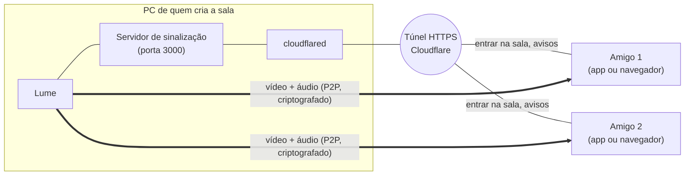

<p align="center">
  
</p>

<h1 align="center">Lume</h1>

<p align="center">
  Compartilhe sua tela com áudio com os amigos, no estilo do Discord, sem servidor pago e sem conta.<br>
  <b>Electron + WebRTC</b> · Windows
</p>

<p align="center">
  <a href="https://github.com/LuisFilipeZM/lume/releases/latest">
    
  </a>
</p>

---

## O que é

O Lume é um programa para assistir à tela de alguém junto com os amigos: um jogo, um filme, um código, uma apresentação. Uma pessoa cria a sala, manda o link, e quem entra vê e ouve tudo em tempo real. Várias pessoas podem compartilhar ao mesmo tempo, e as telas se organizam sozinhas na janela.

Quem só quer **assistir** não precisa instalar nada: o link abre no navegador. O app desktop é para quem quer **compartilhar** com a melhor qualidade.

## Recursos

- **Salas por link:** crie uma sala e copie o link público com um clique.
- **Seletor de tela confiável:** toda captura passa por uma janela do próprio Lume, que mostra quem está pedindo. Nenhuma página consegue capturar sua tela ou seu áudio sem a sua escolha.
- **Tela ou janela, com o áudio certo:**
  - **Janela:** vai junto só o som daquele aplicativo. O Discord e outros programas não vazam para quem assiste.
  - **Tela inteira:** vai todo o som do PC, menos o do próprio Lume, o que evita eco de quem você está assistindo.
- **Até 1080p a 60 fps**, com codec H.264 (usa a placa de vídeo) ou VP9.
- **Vários espectadores e vários compartilhando ao mesmo tempo** (até 12 pessoas por sala).
- **Senha opcional na sala:**
  - quem cria a sala pode definir uma senha, e em branco a sala fica aberta;
  - a senha não vai no link: mande separado;
  - salas com senha mostram um 🔒 no topo.
- **Prévia antes de assistir:** quando alguém compartilha, os outros veem só uma prévia leve (sem som). Quem quiser assistir clica em **▶ Assistir** e recebe a tela em qualidade total com áudio. O ✕ volta para a prévia, e quem compartilha vê quantas pessoas estão assistindo.
- **Layout automático:** as telas se reorganizam para ficar o maior possível.
- **Volume e tela cheia** separados para cada tela.
- **Sons de aviso** quando alguém entra, sai, começa ou para de compartilhar (dá para desligar).
- **Fica na bandeja:** fechar a janela não encerra o app, e a sala continua no ar.
- **Economia de recursos:**
  - cada espectador recebe só a resolução que está usando;
  - quem minimiza deixa de receber vídeo (o áudio continua);
  - a prévia da própria tela é leve.
- **Link público automático** via túnel da Cloudflare, sem abrir portas no roteador.
- **Atualização automática:** o app avisa quando sai uma versão nova e, se você aceitar, baixa, confere, troca os arquivos e reabre sozinho.

## Como funciona



1. **Quem cria a sala** liga um pequeno servidor no próprio PC. O `cloudflared` expõe esse servidor na internet com um endereço `https://...trycloudflare.com`, sem precisar mexer no roteador.
2. **Os amigos** abrem o link. O servidor só faz a **sinalização**: quem entrou, quem saiu, quem está compartilhando e a troca de dados para os computadores se encontrarem.
3. **O vídeo e o áudio não passam pelo servidor.** Eles vão direto de um computador para o outro via **WebRTC**, criptografados de ponta a ponta (DTLS-SRTP). Um servidor STUN público do Google ajuda os PCs a descobrirem o endereço público um do outro, mesmo atrás de roteadores diferentes.
4. Quem compartilha envia **um fluxo para cada espectador**. Por padrão é só uma prévia: 320×180, 2 quadros por segundo e sem áudio, cerca de 150 kbps. Quando o espectador clica em **Assistir**, o fluxo dele passa para a qualidade total com áudio, ajustada ao tamanho em que ele vê a tela. Assim o upload de quem compartilha só é gasto com quem realmente está assistindo.

## Instalação e uso

### Baixar pronto (recomendado)

1. Baixe o `.zip` da **[última release](https://github.com/LuisFilipeZM/lume/releases/latest)**.
2. Descompacte a pasta inteira e abra o `Lume.exe`.

Não precisa instalar Node.js. Na primeira vez, o Windows SmartScreen avisa que o app não é reconhecido: clique em **Mais informações → Executar assim mesmo**.

### Rodar a partir do código

#### Requisitos

- Windows 10 versão 2004 ou mais novo, ou Windows 11
- [Node.js](https://nodejs.org) 18 ou superior
- [cloudflared](https://developers.cloudflare.com/cloudflare-one/connections/connect-networks/downloads/), para o link público: `winget install --id Cloudflare.cloudflared`

#### Rodar

```bash
npm install
npm start
```

- **Criar uma sala:** inicia o servidor. Deixe "Criar link público" marcado, entre na sala e clique em **Copiar link** para mandar aos amigos.
- **Entrar na sala de um amigo:** cole o link que ele te mandou.
- **Compartilhar:** clique em **Compartilhar tela**. O Lume abre o seletor: escolha a tela ou janela, confirme se quer o áudio e clique em **Compartilhar**. Na barra de baixo você ajusta qualidade, codec e prioridade (movimento ou nitidez).

### Gerar o executável

```bash
npm run dist
```

O resultado fica em `dist/Lume-win32-x64/`. Para distribuir, compacte **a pasta inteira**, porque o `Lume.exe` depende dos outros arquivos dela. Para que a atualização automática reconheça a release, siga o passo a passo em [Publicar uma versão nova](#publicar-uma-versão-nova).

## Atualizações

- **Quando verifica:** 10 segundos depois de abrir e a cada 6 horas. Também dá para pedir na hora, pelo ícone da bandeja, em **Procurar atualizações**.
- **O aviso:** se houver versão nova, aparece uma janela do Windows com **Atualizar agora**, **Depois**, **Pular esta versão** e **Ver novidades**. Nada é baixado sem você aceitar.
- **Ao atualizar:**
  1. o Lume baixa o zip da release e confere o tamanho e o SHA-256;
  2. extrai o zip e abre a **versão nova** em "modo atualizador" (sem janela). O Lume antigo só fecha depois que ela confirma que está rodando;
  3. a versão nova espera o Lume antigo fechar, copia os arquivos por cima e abre o Lume atualizado, que mostra "Lume atualizado para a vX.Y.Z".
  
  Arquivos que você colocou na pasta, como um `cloudflared.exe`, não são apagados. A troca não usa PowerShell nem scripts, padrão que antivírus costumam bloquear.
- **Se algo der errado:** você continua na versão atual. O aviso aparece na hora ou, se a troca for interrompida, na próxima vez que abrir o Lume, com a opção de baixar manualmente.
- **Registro:** cada etapa fica em `atualizacao.log`, na pasta de dados do Lume (`%APPDATA%\Lume`). Para abrir, use o ícone da bandeja → **Ver registro de atualização**.
- **Limitações:**
  - só funciona no `Lume.exe` gerado, não no `npm start`;
  - a pasta do Lume precisa aceitar escrita, então não funciona dentro de "Arquivos de Programas";
  - **quem está na v1.10.0 ou v1.11.0 precisa instalar a v1.11.1 manualmente uma vez.** O atualizador dessas versões não funcionava, e a correção só vale a partir da v1.11.1.

### Publicar uma versão nova

O atualizador só reconhece releases que seguem este padrão:

1. Atualize `"version"` no `package.json`, por exemplo `1.10.0`.
2. Gere e compacte, no PowerShell, dentro da pasta do projeto:
   ```powershell
   npm run dist
   Rename-Item dist\Lume-win32-x64 Lume
   Compress-Archive -Path dist\Lume -DestinationPath dist\Lume-v1.10.0-win-x64.zip
   Get-FileHash dist\Lume-v1.10.0-win-x64.zip -Algorithm SHA256
   ```
   Dentro do zip precisa haver a pasta **`Lume`** com o `Lume.exe`.
3. Crie a release no GitHub:
   - **tag:** `v1.10.0`;
   - **anexo:** `Lume-v1.10.0-win-x64.zip`;
   - **nas notas, esta linha com o hash:**
     ```
     SHA-256 de `Lume-v1.10.0-win-x64.zip`: `<hash do Get-FileHash>`
     ```
4. Não marque como "pre-release": o atualizador ignora pré-releases e rascunhos.

### Só o servidor, sem o app

```bash
npm run server
```

Abre em http://localhost:3000. Para compartilhar pelo navegador fora do seu PC é preciso HTTPS (por exemplo, `cloudflared tunnel --url http://127.0.0.1:3000`).

## Testes

Requer Node.js 22 ou mais novo.

```bash
npm test            # rápidos (segundos): servidor, senha, bloqueio e atualizador
npm run test:e2e    # completos (~1 min): sala no navegador e app Electron, incluindo o seletor
npm run test:all    # os dois
```

- Os testes completos usam o Playwright. Na primeira vez, rode `npx playwright install chromium`.
- Eles abrem o app com uma pasta de dados própria, então funcionam mesmo com o Lume aberto.
- **No Linux**, rode os completos com um servidor gráfico virtual: `xvfb-run -a npm run test:e2e`.

**O que fica de fora** (só dá para testar à mão, no Windows):
- a captura real da tela e do áudio por aplicativo;
- a troca de arquivos e a reabertura da atualização automática.

Nos testes, as telas e o áudio são simulados.

## Configuração

| O quê | Como |
|---|---|
| Porta | Na tela inicial do app, ou pela variável `PORT` no modo só servidor (padrão `3000`) |
| Servidor TURN | Variáveis `TURN_URL`, `TURN_USER` e `TURN_PASS` antes de iniciar. Só quem cria a sala precisa configurar |
| Ícone | Substitua `build/icon.ico` e `build/icon.png`. Há opções prontas em `build/alternativas/` |

## Riscos e limitações

O Lume é um **projeto pessoal, feito para uso entre amigos de confiança**. Ele não passou por auditoria de segurança. Antes de usar, conheça os pontos abaixo.

### Risco médio

- **Entrar na sala de outra pessoa roda o código dela dentro do Lume.**
  - **O que mudou:** desde o seletor confiável, essa página **não consegue capturar sua tela nem seu áudio sem você escolher** no seletor do Lume, que avisa em destaque quando o pedido vem da sala de outra pessoa.
  - **O que continua:** se você compartilhar, quem criou a sala recebe a imagem e o som e pode gravar ou repassar.
  - **Atenção:** se o seletor aparecer sem você ter clicado em **Compartilhar tela**, cancele.
  - **Na dúvida:** prefira entrar em links de quem você confia. Para só assistir a um link desconhecido, use o navegador.

- **Sem senha, o link é a única proteção.** Numa sala aberta, quem tiver o link entra e vê tudo o que for compartilhado.
  - **Use senha** se o link puder circular, e não publique o link em lugares abertos.
  - **Com senha:**
    - ela fica só na memória do PC de quem criou, como hash, e some quando a sala esvazia;
    - depois de 5 tentativas erradas, o IP fica bloqueado por 1 minuto;
    - a senha protege a entrada na sala, mas **não é uma senha forte contra ataques**: use algo que não seja óbvio.
  - **Não há aprovação** de novos participantes por quem criou a sala.
- **O servidor aceita conexões da rede local.** Qualquer pessoa no mesmo Wi-Fi consegue acessar `http://SEU-IP:3000`.
- **Seu IP fica visível para quem está na sala.** Como a conexão é direta (P2P), os participantes veem o IP público uns dos outros.
- **Você pode mostrar mais do que pretende.** Compartilhar a tela inteira expõe notificações, mensagens e outras janelas. O áudio também vai inteiro, incluindo chamadas do Discord e notificações. Prefira compartilhar só uma janela: assim vai apenas a imagem e o som daquele aplicativo.

### Risco baixo e limitações

- **Servidor sem proteção contra abuso:** não verifica a origem das conexões nem limita conexões e salas.
- **Links `http://`:** o conteúdo pode ser alterado no caminho. Use sempre o link `https://`.
- **Atualização confia nas releases do repositório:**
  - como o `.exe` não é assinado, quem conseguir publicar uma release neste repositório consegue distribuir uma "atualização" para todos os usuários;
  - o SHA-256 só garante que o download chegou inteiro, não quem o publicou;
  - mantenha a **autenticação em dois fatores** ligada na conta do GitHub.
- **Credenciais TURN visíveis:** se configuradas, são enviadas a todos os participantes da sala.
- **Dependências sem versão fixa:** `electron` e o empacotador estão em `latest`.
- **Módulos nativos de terceiros:** a captura de áudio por aplicativo usa `loopback-capture` (WASAPI) e `koffi`, que trazem binários já compilados. As versões estão fixadas, e o código nativo do `loopback-capture` foi revisado antes da inclusão.
- **`cloudflared` procurado por pasta:** o app procura o programa também na pasta atual. Um arquivo falso com esse nome ali seria executado.
- **`.exe` sem assinatura digital:** o Windows SmartScreen mostra um alerta.
- **Túnel gratuito da Cloudflare:** não tem garantia de disponibilidade, e a Cloudflare enxerga o tráfego de sinalização (não o vídeo).
- **Qualquer espectador pode gravar** o que você compartilha.
- **Upload limita o número de espectadores:** cada pessoa assistindo consome até ~8 Mbps do seu upload em 1080p60 (o padrão), ou ~5 Mbps em 1080p30. Quem está só na prévia gasta ~0,15 Mbps.
- **Algumas redes bloqueiam a conexão direta:** CGNAT de operadora, 4G/5G e redes corporativas podem exigir um servidor TURN.
- **Áudio só no Windows:**
  - o áudio por aplicativo precisa do Windows 10 versão 2004 ou mais novo, ou do Windows 11. Sem isso, a janela é compartilhada sem som;
  - apps da Microsoft Store podem ficar sem som, porque a janela pertence a outro processo do Windows. Nesse caso, compartilhe a tela inteira.

### O que já está protegido

- Vídeo e áudio são criptografados de ponta a ponta pelo WebRTC.
- **Seletor de tela confiável:**
  - a captura só começa depois da escolha numa janela do próprio Lume, isolada da página;
  - a página não lista telas nem janelas, não vê miniaturas e não consegue ligar a captura de áudio;
  - pedidos sem clique do usuário, de outra origem ou repetidos logo após um cancelamento são recusados;
  - a forma antiga do Electron de capturar a tela também é bloqueada.
- A interface isola a página do sistema: sem acesso ao Node.js e com `contextIsolation` ligado. A janela não navega para fora da sala.
- Nomes de usuário e de sala são exibidos como texto, sem executar código.

## Próximos passos

- [x] Seletor de tela confiável no próprio app, para que nenhuma página consiga capturar sem confirmação
- [ ] Servidor escutando só em `127.0.0.1` por padrão
- [x] Senha da sala
- [ ] Aprovação de novos participantes por quem criou a sala
- [ ] Configuração de TURN na tela inicial
- [ ] Indicador de "ao vivo" no ícone da bandeja
- [ ] Versões fixas das dependências e `.exe` assinado

## Estrutura

```
app/                    processo principal do Electron
  index.js              inicialização: modo atualizador, instância única, liga as partes
  ipc.js                todos os canais chamados pelas páginas e quem pode chamar cada um
  window.js             janela, bandeja e navegação (tela inicial <-> sala)
  room-host.js          servidor da sala nesta máquina e túnel público
  updates.js            avisos e fluxo de atualização
  capture/picker.js     seletor de tela confiável (toda captura passa por ele)
  capture/app-audio.js  áudio por aplicativo
  state.js, paths.js    estado compartilhado e caminhos
preload.js              ponte segura entre as páginas e o app
picker.html             janela do seletor de tela
picker-preload.js       ponte do seletor, isolada da página da sala
server.js               servidor de sinalização (HTTP + WebSocket, salas e senha)
updater.js              atualização: consulta, download conferido, extração e troca de arquivos
start.html              tela inicial do app (criar ou entrar em sala)
public/index.html       sala: interface, WebRTC, layout e sons
build/                  ícones do app e alternativas
tests/unit/             testes rápidos (node:test)
tests/e2e/              testes completos (Playwright: navegador e app Electron)
```

**Para adicionar um canal entre a página e o app:** declare-o na tabela de `app/ipc.js`, dizendo quem pode chamá-lo (`start` ou `room`), e exponha-o no `preload.js`. O teste `tests/unit/ipc.test.js` falha se os dois não baterem.
